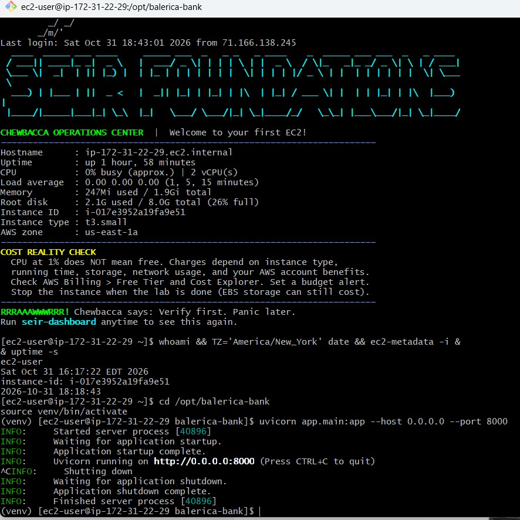
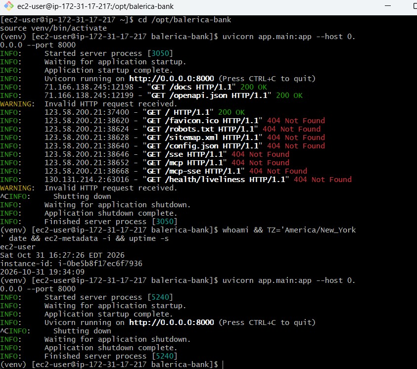
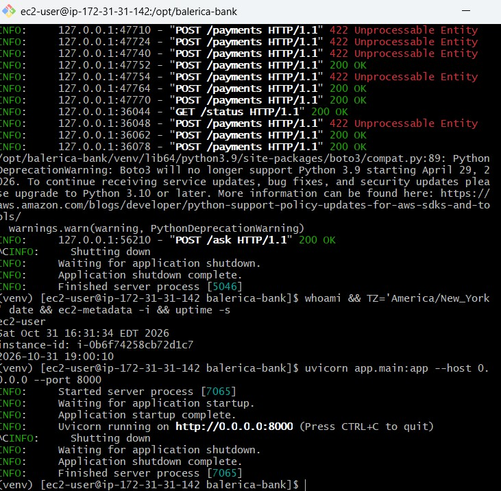
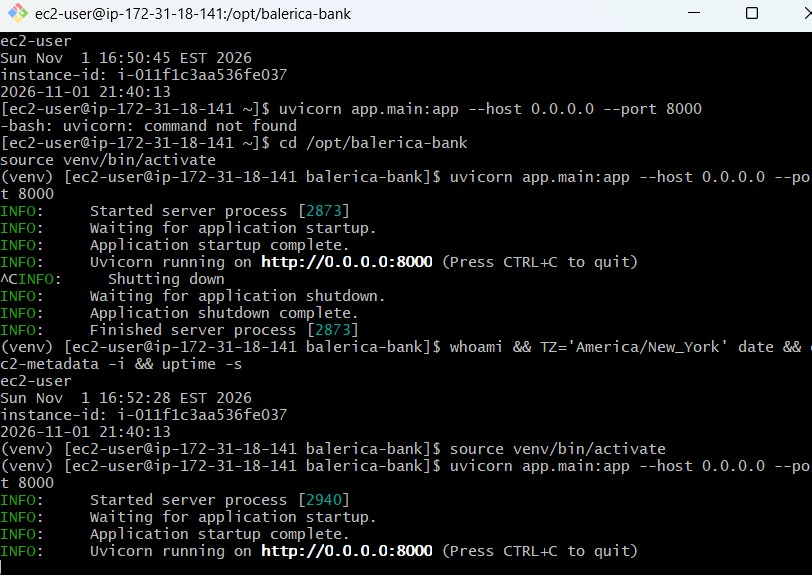
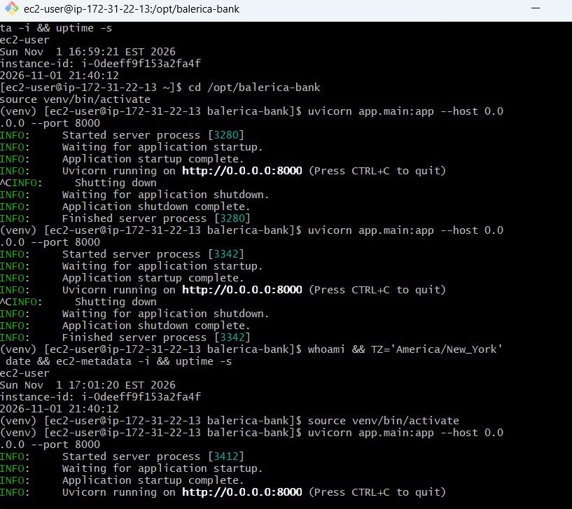
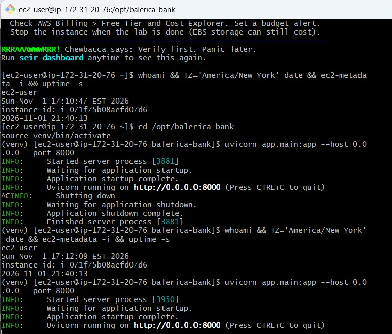
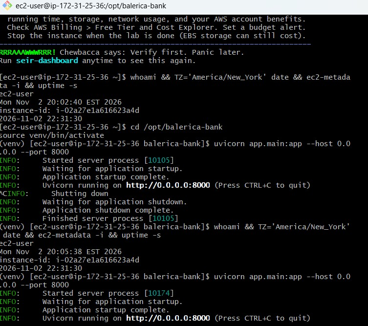

# SEIR Foundations — Week 3 Homework
## Module 1 / Lesson 1 — EC2 + Balerica Legacy Bank

**Student:** Alex Petit  
**Lab dates:** October 31 – November 2, 2026 (America/New_York)  
**EC2 region:** us-east-1  
**Reference:** [Week 3 assignment](https://github.com/rofoed01/TheoWaf_SEIR-Foundations/blob/main/module1/lesson1_ec2/lab1.0_wk3_homework.md)

This README organizes the Week 3 evidence for seven manual EC2 lab runs, the Maarek quizzes, the COBOL exercises, the Git clone proof, and the written research and review files.

## Section 3 — Seven EC2 lab runs

### 3.4 Evidence table

All seven run screenshots show the `ec2-user` account, the local timestamp, the EC2 instance ID, the UTC boot timestamp, and Uvicorn application startup. Boot times below remain in **UTC**, as required by the assignment; the dates in the second column are the dates shown in local Eastern time. All seven instances were terminated.

| Run | Date (local) | Time zone | Instance ID | Boot time (UTC) | Public IPv4 DNS | Screenshot | Terminated? |
| --- | --- | --- | --- | --- | --- | --- | --- |
| 1 | 2026-10-31 | America/New_York | `i-017e3952a19fa9e51` | 2026-10-31 18:18:43 | `ec2-100-31-117-55.compute-1.amazonaws.com` |  | Yes |
| 2 | 2026-10-31 | America/New_York | `i-0be5b8f17ec6f7936` | 2026-10-31 19:34:09 | `ec2-32-201-54-27.compute-1.amazonaws.com` |  | Yes |
| 3 | 2026-10-31 | America/New_York | `i-0b6f74258cb72d1c7` | 2026-10-31 19:00:10 | `ec2-54-196-144-52.compute-1.amazonaws.com` |  | Yes |
| 4 | 2026-11-01 | America/New_York | `i-011f1c3aa536fe037` | 2026-11-01 21:40:13 | `ec2-50-19-31-17.compute-1.amazonaws.com` |  | Yes |
| 5 | 2026-11-01 | America/New_York | `i-0deeff9f153a2fa4f` | 2026-11-01 21:40:12 | `ec2-98-88-248-190.compute-1.amazonaws.com` |  | Yes |
| 6 | 2026-11-01 | America/New_York | `i-071f75b08aefd07d6` | 2026-11-01 21:40:13 | `ec2-34-207-82-34.compute-1.amazonaws.com` |  | Yes |
| 7 | 2026-11-02 | America/New_York | `i-02a27e1a616623a4d` | 2026-11-02 22:31:30 | `ec2-54-91-199-12.compute-1.amazonaws.com` |  | Yes |

**Screenshot date distribution:** October 31 (Runs 1–3), November 1 (Runs 4–6), and November 2 (Run 7). This meets the maximum of three lab-run screenshots per local date. November 1 timestamps are Eastern Standard Time (EST); October 31 timestamps are Eastern Daylight Time (EDT).

### 3.5 Personal run notes

Seven run narratives, exact Uvicorn output lines, the lessons learned, the "Mistakes I made" list, and the "Commands I now know by heart" list are provided in [lab1_notes.md](lab1_notes.md).

## Section 4 — Stéphane Maarek quiz results

The three quiz screenshots were completed November 1, 2026 (EST).

| Quiz | Correct | Total | Score | Screenshot |
| --- | ---: | ---: | ---: | --- |
| Section 21 | 9 | 9 | 100% | [Maarek_Section21_quiz.jpg](screenshots/Maarek_Section21_quiz.jpg) |
| Section 23 | 13 | 13 | 100% | [Maarek_Section23_quiz.jpg](screenshots/Maarek_Section23_quiz.jpg) |
| Section 25 | 5 | 5 | 100% | [Maarek_Section25_quiz.jpg](screenshots/Maarek_Section25_quiz.jpg) |
| **Total** | **27** | **27** | **100%** | **3 screenshots** |

## Section 5 — AI review

[ai_review_AlexPetit.txt](ai_review_AlexPetit.txt) records five questions about the Balerica runbook, ChatGPT answer summaries, methods used to check the answers, and the AI responses that required clarification. The ChatGPT conversation share link is included at the top of that file.

## Section 6 — Spotter check-in

[spotter_AlexPetit.txt](spotter_AlexPetit.txt) identifies Zac Smith as my spotter and Sid Owsley as the person I spotted for, with five learning points in each half of the report.

## Section 7 — COBOL practice

The [COBOL practice section of lab1_notes.md](lab1_notes.md) documents the customer records, return codes, exact commands and output, fixed-width ledger decoding, posted/rejected transactions, and the final account-balance check.

| Exercise | Recorded result | Evidence |
| --- | --- | --- |
| Return code 0 | Successful lookup for account 100001 | [cobol_rc0.jpg](screenshots/cobol_rc0.jpg) |
| Return code 4 | Account 999999 not found | [cobol_rc4.jpg](screenshots/cobol_rc4.jpg) |
| Return code 8 | Zero-dollar rejection and insufficient-funds rejection | [cobol_rc8.jpg](screenshots/cobol_rc8.jpg) |
| Return code 12 | `FILE-STATUS=35` when run from the wrong directory | [cobol_rc12.jpg](screenshots/cobol_rc12.jpg) |
| Fixed-width ledger | Account IDs, names, statuses, balances, currencies | [cobol_ledger_decode.jpg](screenshots/cobol_ledger_decode.jpg) |

**Instance used for COBOL practice:** Run 7, `i-02a27e1a616623a4d` (tests on November 3, 2026). Alice Johnson's 12-character balance field `000000403764` decodes to **$4,037.64**. The journal records `TXN-AP-0003` as `POSTED` and `TXN-AP-0004` as `REJECTED` with insufficient funds; the observed account balance remained $4,037.64.

## Section 8 — Git clone

[git_clone.jpg](screenshots/git_clone.jpg) shows the Run 7 EC2 identity line, `cd ~`, the successful `git clone` of the public homework repository, and a successful listing of `seir-foundations-homework/module1`.

## Section 9 — AI-enabled study

The five topic write-ups, reading references, video references, research prompts, checked claims, original paragraphs, and numerical sources are in [AI_enabled_study_lab1.0.txt](AI_enabled_study_lab1.0.txt).

| Topic | Focus | Written evidence |
| --- | --- | --- |
| 1 — Databases | SQL vs. NoSQL, database selection, SQLite in Balerica | [Topic 1](AI_enabled_study_lab1.0.txt) |
| 2 — COBOL | Legacy banking code, return codes, implied decimals | [Topic 2](AI_enabled_study_lab1.0.txt) |
| 3 — SWIFT | MT103, ISO 20022, pacs.008/pacs.009, current messaging | [Topic 3](AI_enabled_study_lab1.0.txt) |
| 4 — APIs | HTTP, REST, JSON, GET/POST, security | [Topic 4](AI_enabled_study_lab1.0.txt) |
| 5 — System integration | COBOL + SWIFT + FastAPI + SQLite and modernization | [Topic 5](AI_enabled_study_lab1.0.txt) |

## Submission contents

The `screenshots/` folder contains seven EC2 run images, three quiz results, four return-code screenshots, one ledger-decoding screenshot, and the Git-clone screenshot. All evidence files use the assignment's specified names. Section 10 (BAM) is optional extra credit and is not included.
